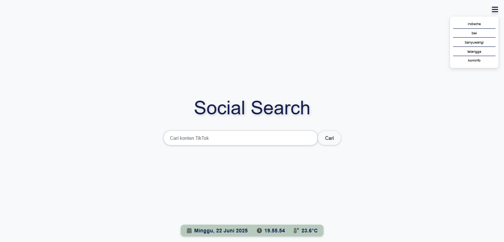
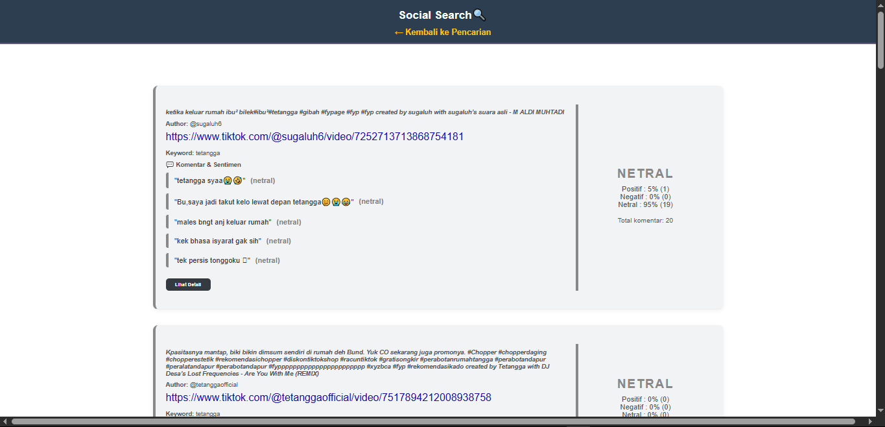
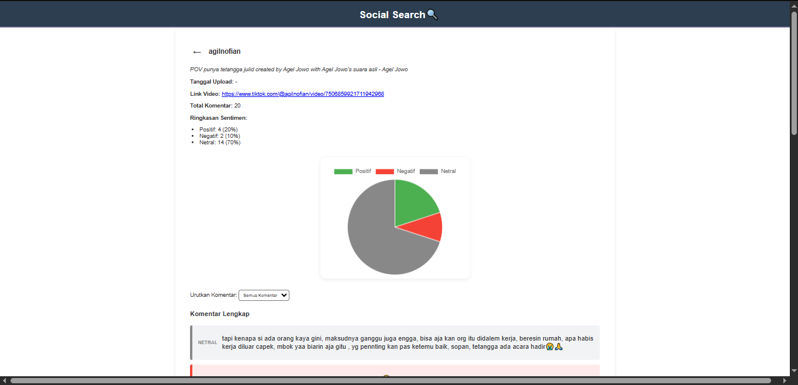

# Social Search

[](https://github.com/mhmmd-naufl/social_searchv2/actions/workflows/ci.yml)

Aplikasi pencarian konten TikTok yang mengambil komentar lalu menganalisis
sentimennya (positif / negatif / netral). Dibuat sebagai proyek magang semester
dan disusun ulang agar siap dipakai sebagai portofolio.

## Tampilan

| Halaman | Tampilan |
|---|---|
| Pencarian |  |
| Hasil & ringkasan sentimen |  |
| Detail + grafik pie |  |

> Screenshot tersebut adalah dokumentasi tampilan awal. Antarmuka terbaru
> menggunakan desain minimalis dan tidak menampilkan informasi cuaca.

## Fitur utama

- Scraping TikTok via Selenium dengan **beberapa selector cadangan** dan scroll
  otomatis pada hasil maupun daftar komentar.
- Analisis sentimen leksikon bahasa Indonesia: normalisasi slang, penanganan
  negasi, frasa multi-kata, dan emoji.
- Pro scraping dijalankan sebagai **job background**; frontend melakukan
  polling, dengan deduplikasi job untuk keyword yang sama.
- MongoDB dengan **upsert** agar tidak ada duplikat saat scraping ulang.
- REST API FastAPI + dokumentasi interaktif di `/docs`.
- UI minimalis dan responsif dengan state loading, kosong, dan error yang jelas.
- Unit & API test, CI GitHub Actions, dan Dockerfile + Docker Compose.

## Tech stack

| Layer | Teknologi |
|---|---|
| Frontend | React 19, Vite 6, React Router 7, Chart.js |
| Backend | FastAPI, Uvicorn, Selenium, PyMongo |
| Database | MongoDB |
| Analisis | NLTK stopwords, Sastrawi stemmer, leksikon buatan sendiri |
| Kualitas | pytest, ruff, GitHub Actions, `npm audit` (0 vulnerability) |
| Deployment | Docker, Docker Compose |

## Struktur folder

```
.
├── backend/
│   ├── app/
│   │   ├── main.py              # endpoint FastAPI
│   │   ├── config.py            # konfigurasi dari environment variable
│   │   ├── database.py          # koneksi MongoDB singleton + index
│   │   ├── jobs.py              # job background + deduplikasi
│   │   ├── scrapper.py          # scraping halaman pencarian
│   │   ├── scrapper_comment.py  # scraping komentar
│   │   ├── save.py              # upsert ke MongoDB
│   │   ├── selenium_driver.py   # browser Windows/Linux
│   │   ├── cookies.py           # loader cookie (tanpa hardcode)
│   │   └── analysis/            # leksikon, preprocessing, evaluator, KBBI
│   ├── tests/                   # test analisis, job, dan API
│   ├── requirements.txt
│   └── requirements-dev.txt
├── frontend/src/
│   ├── App.jsx      # halaman pencarian
│   ├── Hasil.jsx    # hasil + polling job
│   └── Detail.jsx   # detail video + grafik
├── Screenshot/                  # dokumentasi UI
├── docker-compose.yml
└── indonesian-adjective-sentiment-raw.csv
```

## Menjalankan proyek

### Opsi A — Docker Compose (paling mudah)

```bash
copy backend\.env.example backend\.env
copy frontend\.env.example frontend\.env
docker compose up --build
```

- Frontend: `http://localhost:5173`
- API docs: `http://localhost:8000/docs`
- MongoDB: `localhost:27017`

### Opsi B — Lokal

Backend:

```bash
cd backend
python -m venv .venv
.venv\Scripts\activate
pip install -r requirements-dev.txt
python -m nltk.downloader stopwords
copy .env.example .env          # isi API key & cookie Anda
cd ..
uvicorn app.main:app --app-dir backend --reload --port 8000
```

Frontend:

```bash
cd frontend
npm install
copy .env.example .env
npm run dev
```

## Konfigurasi

| Variable | Default | Keterangan |
|---|---|---|
| `MONGO_URI` | `mongodb://localhost:27017` | Alamat MongoDB |
| `DB_NAME` | `new_tiktok_db` | Nama database |
| `COLLECTION_NAME` | `videos` | Nama koleksi |
| `CORS_ORIGINS` | `http://localhost:5173` | Origin yang diizinkan |
| `TIKTOK_COOKIES_JSON` | kosong | Cookie TikTok sebagai JSON array |
| `TIKTOK_COOKIES_FILE` | `backend/app/cookies.json` | File cookie lokal |
| `USE_KBBI_LEXICON` | `0` | `1` untuk leksikon tambahan dari KBBI |
| `CHROMEDRIVER_PATH` | otomatis | Path chromedriver |
| `BROWSER_BINARY` | otomatis | Path Brave/Chromium |
| `HEADLESS` | `0` | `1` untuk mode headless |
| `VITE_API_URL` | `http://localhost:8000` | Base URL API (frontend) |

## API endpoint

| Method | Endpoint | Deskripsi |
|---|---|---|
| `GET` | `/` | Health check |
| `POST` | `/search?keyword=...` | Mulai job scraping, mengembalikan `job_id` |
| `GET` | `/search/status/{job_id}` | Status job: `pending`/`running`/`done`/`failed` |
| `GET` | `/search?keyword=...` | Endpoint lama (blocking, kompatibilitas) |
| `GET` | `/video?video_id=...` | Detail satu video |
| `GET` | `/docs` | Dokumentasi interaktif Swagger |

## Analisis sentimen

Pipeline:

1. Lowercase, emoji dipisahkan dan dipertahankan.
2. Normalisasi slang (`gak` → `tidak`, `bgt` → `sangat`, dll.).
3. Frasa multi-kata dikenali **sebelum** stopword dibuang, sehingga
   `"luar biasa"` tidak hilang walaupun `luar`/`biasa` adalah stopword.
4. Stopword dibuang, kata di-stem dengan Sastrawi; kata negasi tetap disimpan.
5. Leksikon juga memuat varian hasil stemming (`berhasil` → `hasil`).
6. Negasi membalik skor token berikutnya: `"tidak suka"` → negatif.
7. Skor > 0 → `positif`, < 0 → `negatif`, selebihnya → `netral`.

### Evaluasi

```bash
cd backend
python -m app.analysis.evaluate
```

Contoh 36 komentar berlabel di `backend/tests/data/labeled_comments.json`
digunakan untuk mendemonstrasikan metrik. Hasil saat ini:

| Kelas | Precision | Recall | F1 | Support |
|---|---|---|---|---|
| positif | 1.000 | 1.000 | 1.000 | 12 |
| negatif | 1.000 | 1.000 | 1.000 | 12 |
| netral | 1.000 | 1.000 | 1.000 | 12 |

**Accuracy: 100% (36/36).** Dataset ini sengaja dibuat kecil dan kuratif untuk
menunjukkan cara kerja evaluasi — **bukan benchmark representatif**. Untuk
pengukuran yang kredibel dibutuhkan ratusan komentar berlabel dari data nyata.

File `indonesian-adjective-sentiment-raw.csv` adalah kamus KBBI **tanpa label
sentimen**, jadi tidak dapat dipakai untuk training supervised. Skrip
`lexicon_builder.py` memakai definisinya untuk membangun leksikon tambahan
(`lexicon_kbbi.json`, opsional via `USE_KBBI_LEXICON=1`).

## Testing

```bash
cd backend
python -m pytest        # 21 test: analisis, job, API
ruff check app tests    # lint
```

CI di `.github/workflows/ci.yml` menjalankan test backend dan build frontend
pada setiap push.

## Catatan

- Cookie TikTok sensitif dan cepat kedaluwarsa. Jangan pernah meng-commit
  cookie atau API key; keduanya sudah masuk `.gitignore`.
- Riwayat git lama sudah dibersihkan dari secret dengan `git filter-repo`.
  Tetap lakukan rotasi kredensial jika nilai lama pernah dipakai.
- Scraping TikTok bergantung pada struktur halaman yang bisa berubah kapan
  saja. Beberapa selector cadangan sudah disiapkan, tetapi tetap perlu
  pemeliharaan.
- Job disimpan in-memory; gunakan Redis/Celery untuk kebutuhan produksi.
- Jika Anda memiliki clone lama dari repository ini, lakukan `git fetch` +
  `git reset --hard origin/main` karena riwayat pernah di-rewrite.
